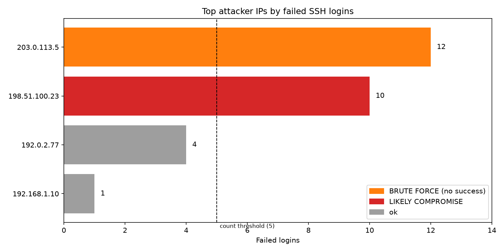
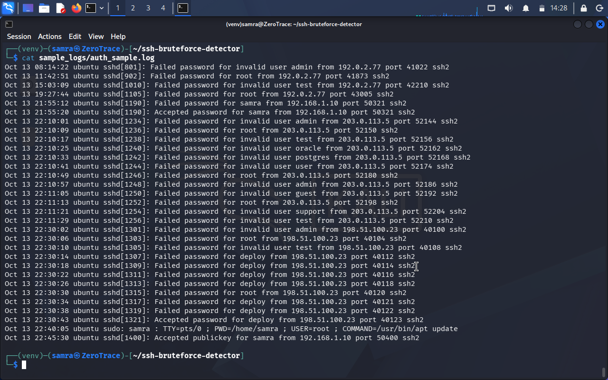
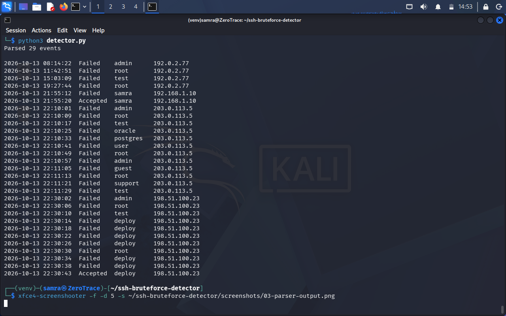
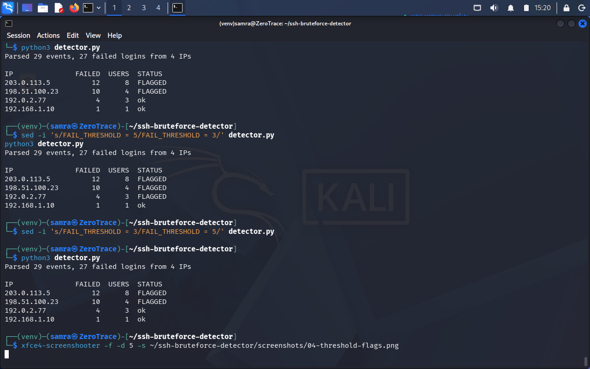
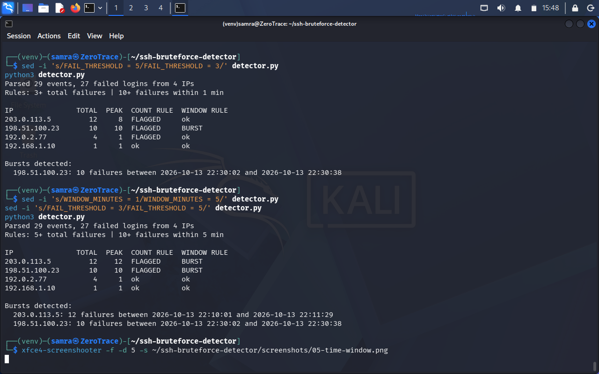
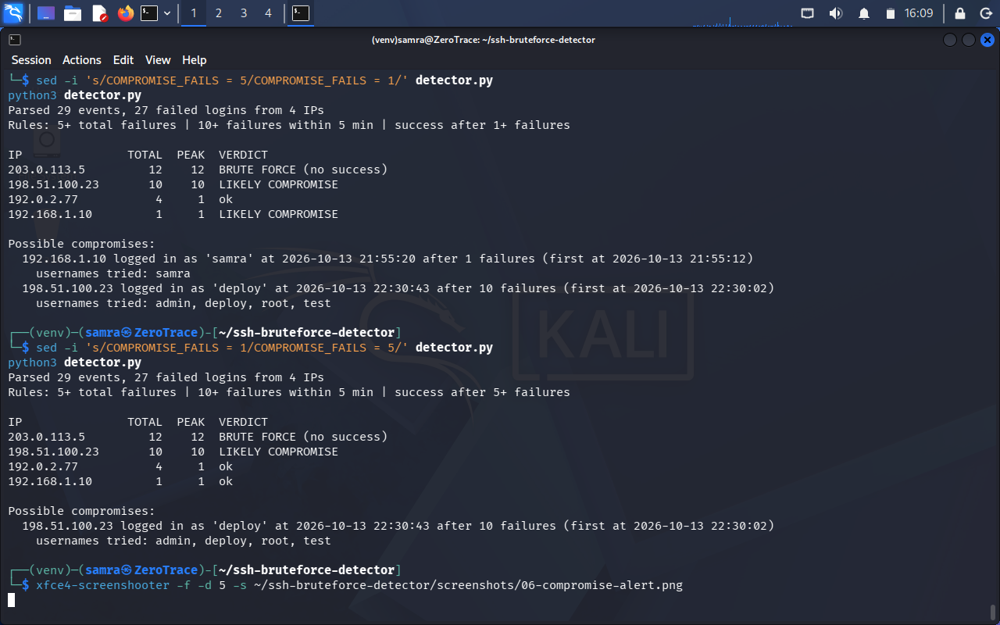
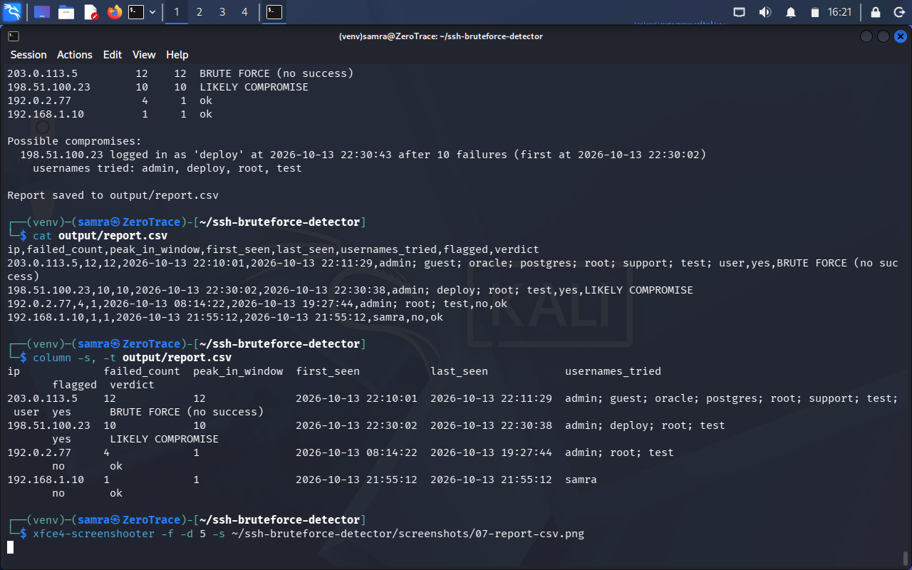

# SSH Brute-Force Detector

A Python tool that reads an SSH `auth.log`, finds brute-force attacks, and tells you **whether the attacker got in**. It applies the same logic a SIEM rule uses (thresholds, time windows, failed-then-accepted correlation), built by hand to show how detections work.

**MITRE ATT&CK:** T1110 Brute Force (T1110.001 Password Guessing), followed by T1078 Valid Accounts when a login succeeds.

Built by Samra Sharafat Ali ([0xsamra](https://github.com/0xsamra)) as a blue-team / SOC analyst portfolio project.

## What it does

1. **Parses** SSH log lines with regex into structured events (time, status, user, IP).
2. **Counts** failed logins per IP and records the usernames each IP tried.
3. **Detects bursts** with a sliding time window (10+ failures within 5 minutes).
4. **Detects likely compromise:** a successful login after 5+ failures from the same IP within 10 minutes.
5. **Exports** a per-IP report to `output/report.csv`.
6. **Charts** the top attacker IPs, coloured by verdict, to `output/top_attackers.png`.

## Project structure

```
ssh-bruteforce-detector/
├── detector.py          # parser, detection rules, CSV report
├── chart.py             # bar chart (imports from detector.py)
├── sample_logs/
│   └── auth_sample.log  # synthetic log with 4 scenarios
├── output/
│   ├── report.csv
│   └── top_attackers.png
├── screenshots/         # proof of each step
└── README.md
```

## How to run

```
git clone https://github.com/0xsamra/ssh-bruteforce-detector.git
cd ssh-bruteforce-detector
python3 -m venv venv
source venv/bin/activate
pip install matplotlib
python3 detector.py
python3 chart.py
```

Only `matplotlib` is installed from outside Python. Everything else (`re`, `csv`, `datetime`, `collections`) is in the standard library.

To analyse your own log, change `LOG_FILE` at the top of `detector.py`. `auth.log` has no year, so set `YEAR` there too.

## Detection rules

| Rule | Setting | What it catches |
|---|---|---|
| Count threshold | 5+ total failures from one IP | Repeated failures, with no sense of time |
| Time window (burst) | 10+ failures within 5 minutes | Automated password guessing |
| Compromise check | Success after 5+ failures in the previous 10 minutes, same IP | An attacker who guessed a password |

All values are constants at the top of `detector.py`.

## Sample data

`sample_logs/auth_sample.log` is a synthetic log (29 password events plus 2 noise lines) with IPs from reserved documentation ranges. It contains four scenarios:

| IP | Scenario | Result |
|---|---|---|
| 203.0.113.5 | 12 failures in about 90 seconds, 8 usernames tried | Brute force, never got in |
| 198.51.100.23 | 10 failures in 36 seconds, then a successful login as `deploy` | **Likely compromise** |
| 192.0.2.77 | 4 failures spread over about 11 hours | Not a burst |
| 192.168.1.10 | 1 mistyped password, then success | Normal user |

## Results

Parsed 29 events and 27 failed logins from 4 IPs.

| IP | Total | Peak in 5 min | Verdict |
|---|---|---|---|
| 203.0.113.5 | 12 | 12 | BRUTE FORCE (no success) |
| 198.51.100.23 | 10 | 10 | LIKELY COMPROMISE |
| 192.0.2.77 | 4 | 1 | ok |
| 192.168.1.10 | 1 | 1 | ok |



## Analyst findings

- **198.51.100.23 is the priority.** It made fewer attempts than 203.0.113.5, but it logged in as `deploy` at 22:30:43 after 10 failures (first at 22:30:02). It tried `admin`, `root`, `test` and `deploy`, which points to an automated tool. Severity is based on outcome, not volume.
- **203.0.113.5 was the loudest attack but failed.** 12 failures in about 90 seconds across 8 usernames (`admin`, `root`, `oracle`, `postgres`, and others), with no successful login.
- **192.0.2.77 is not a burst,** but it tried `admin`, `root` and `test` over several hours. This may be a "low and slow" attacker staying under the time-window rule, so it still deserves a look.
- **192.168.1.10 is normal:** one typo followed by a success.

### Recommended response

1. Confirm the `deploy` login from 198.51.100.23 in the full log.
2. Review what the `deploy` account did after 22:30:43.
3. Reset the account's password and end its active sessions.
4. Block 198.51.100.23 (and 203.0.113.5) at the firewall.
5. Check whether other accounts logged in from the same IPs.

## Tuning

Thresholds are trade-offs. These experiments on the sample log show it:

| Change | Effect |
|---|---|
| Count threshold 5 to 3 | 192.0.2.77 (slow, scattered) becomes a false positive. The time window still ignores it |
| Window 5 minutes to 1 minute | 203.0.113.5 drops to a peak of 8 and stops being a burst. 198.51.100.23 is still caught |
| Compromise failures 5 to 1 | The normal user 192.168.1.10 gets flagged (false positive) |

Too strict misses slower attackers. Too loose floods analysts with alerts.

## Limitations

- Handles only `Failed password` and `Accepted password` lines. Failed or accepted public-key logins and other formats are ignored.
- The verdict says "likely" because a log cannot prove an account was compromised. An analyst has to investigate.
- A slow attacker below the thresholds can go unflagged.
- Matching is by IP, so attacks spread across many IPs are not linked together.

## Screenshots

| Step | Proof |
|---|---|
| Sample log |  |
| Parser output |  |
| Count threshold |  |
| Time window |  |
| Compromise alert |  |
| CSV report |  |
| Chart |  |

## Safety

Only use this on logs from your own systems or labs. Replace real IPs and usernames before publishing any log. This repo uses synthetic data only.

## Possible next steps

- Run it on a real `auth.log` from an Ubuntu lab VM.
- Compare the output with Wazuh's built-in SSH brute-force alerts for the same attack.
- Add a suggested blocklist, public-key login support, and IP reputation checks.
